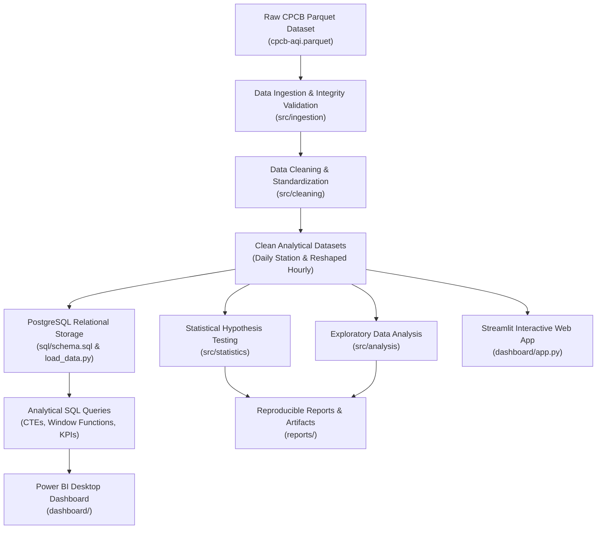

# Project Methodology & Analytical Pre-Registration

## 1. Project Objective and Analytical Scope

This project conducts a comprehensive, reproducible data analysis of air quality dynamics in the Delhi National Capital Region (Delhi-NCR) from **January 1, 2017 to December 31, 2023**.

The investigation addresses three core pillars:
1. **Seasonal and Long-Term Trends**: Monthly, seasonal, and yearly evolution of ambient AQI across the 7-year monitoring window.
2. **Spatial and Station-Level Heterogeneity**: Variation in pollution burdens, monitoring coverage, and severity distribution across 56 stations in Delhi, Gurugram, Faridabad, Ghaziabad, and Noida.
3. **Diwali Pollution Episodes**: Event-study analysis evaluating AQI anomalies around the Diwali festival across 7 consecutive years.

---

## 2. Pre-Registration of Primary Statistical Hypothesis

To prevent p-hacking, confirmation bias, or post-hoc threshold tweaking, the primary statistical question and testing framework are pre-registered below prior to executing inferential tests.

### 2.1 Research Question
> **Is ambient AQI in Delhi-NCR significantly higher during the defined winter period than outside that period?**

### 2.2 Operational Definitions
- **Winter Period ($\text{Period}_W$)**: **November 1 to January 31** (92 calendar days per year; captures the established meteorological temperature inversion and stagnant boundary layer conditions).
- **Non-Winter Baseline ($\text{Period}_{NW}$)**: **February 1 to October 31** (273/274 calendar days per year; encompassing pre-monsoon, monsoon, and early autumn).
- **Secondary Sensitivity Specification**: Core Winter (December 1 to January 31) vs. Monsoon Baseline (July 1 to August 31).

### 2.3 Population and Unit of Analysis
- **Target Population**: Ambient air quality experienced across Delhi-NCR monitoring stations.
- **Unit of Analysis**: **Station-day aggregated mean AQI** ($Y_{s,t}$ where $s$ index station and $t$ indexes date).
- **Avoidance of Pseudoreplication**: Hourly readings from the same station exhibit extreme temporal autocorrelation ($\text{AR}(1) > 0.85$). Treating each hourly observation ($N \approx 2.44\text{ million}$) as an independent draw is statistically invalid and produces pseudo-significance ($p \to 0$). Therefore:
  - Measurements are first aggregated to station-day means with a minimum valid hours threshold ($\ge 16\text{ valid hours per day}$).
  - Station-level paired seasonal comparisons or non-parametric Mann-Whitney / Wilcoxon signed-rank tests are evaluated at the station-aggregate level.

### 2.4 Formal Hypotheses
Let $\mu_W$ denote the true median daily AQI during the winter period, and $\mu_{NW}$ denote the true median daily AQI outside the winter period:
$$\begin{aligned}
H_0 &: \mu_W \le \mu_{NW} \quad \text{(Daily AQI in winter is less than or equal to non-winter AQI)} \\
H_1 &: \mu_W > \mu_{NW} \quad \text{(Daily AQI in winter is strictly higher than non-winter AQI)}
\end{aligned}$$

### 2.5 Decision Rule and Effect Size
- **Significance Level ($\alpha$)**: $0.01$ (conservative two-sided $\alpha = 0.05$, one-tailed rejection region at $0.01$).
- **Primary Test Statistic**: Non-parametric **Mann-Whitney $U$ test** (due to strong positive skewness in pollution distributions) supplemented by a **paired Wilcoxon signed-rank test** across long-operating stations.
- **Effect Size Metric**: **Cliff's Delta ($d$)** and median difference with 95% bootstrap confidence intervals ($B = 2,000$ resamples).
- **Decision Rule**: Reject $H_0$ if $p < 0.01$ and the lower bound of the 95% bootstrap confidence interval of $(\mu_W - \mu_{NW})$ strictly exceeds $0$.

---

## 3. Diwali Episode Event-Study Framework

### 3.1 Event Definition and Verified Festival Dates
Diwali follows the Vikram Samvat lunisolar calendar. Festival dates for each analyzed year are independently verified from official government gazettes:

| Year | Verified Diwali Date ($t_0$) | Pre-Event Window ($t-7$ to $t-1$) | Event Window ($t_0$ to $t+1$) | Post-Event Window ($t+2$ to $t+7$) |
| :---: | :---: | :---: | :---: | :---: |
| **2017** | **October 19, 2017** | Oct 12 – Oct 18 | Oct 19 – Oct 20 | Oct 21 – Oct 26 |
| **2018** | **November 7, 2018** | Oct 31 – Nov 06 | Nov 07 – Nov 08 | Nov 09 – Nov 14 |
| **2019** | **October 27, 2019** | Oct 20 – Oct 26 | Oct 27 – Oct 28 | Oct 29 – Nov 03 |
| **2020** | **November 14, 2020** | Nov 07 – Nov 13 | Nov 14 – Nov 15 | Nov 16 – Nov 21 |
| **2021** | **November 4, 2021** | Oct 28 – Nov 03 | Nov 04 – Nov 05 | Nov 06 – Nov 11 |
| **2022** | **October 24, 2022** | Oct 17 – Oct 23 | Oct 24 – Oct 25 | Oct 26 – Oct 31 |
| **2023** | **November 12, 2023** | Nov 05 – Nov 11 | Nov 12 – Nov 13 | Nov 14 – Nov 19 |

### 3.2 Analytical Metrics
1. **Absolute Peak**: Maximum hourly AQI recorded across the network during the 48-hour window centered on Diwali night.
2. **Episode Magnitude ($\Delta_{\text{Diwali}}$)**: Percentage and absolute increase in network median AQI from pre-event baseline ($t-7$ to $t-1$) to event peak ($t_0$ to $t+1$).
3. **Dissipation Velocity**: Number of days required for network median AQI to return to within 15% of the pre-event 7-day rolling median.
4. **Causal Caveat**: Increased pollution during Diwali coincides with seasonal agricultural biomass burning in neighboring states and seasonal meteorological cooling. Findings must be reported as **observed episode associations**, not purely isolated fireworks-caused increments, unless meteorological controls are explicitly standardized.

---

## 4. End-to-End Pipeline Architecture

