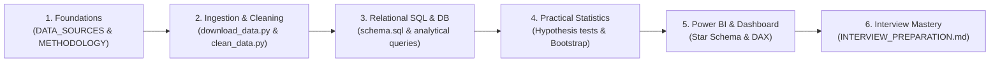

# Data Analyst Portfolio Learning Guide

Welcome to the **Delhi-NCR Air Quality Analysis** portfolio project! This guide is written specifically for B.Tech Computer Science and beginner Data Analyst candidates. It bridges theoretical classroom knowledge (Python syntax, SQL syntax, basic math) with **real-world analytical practice**.

---

## 1. Study Roadmap & Recommended Learning Sequence

Follow this sequenced path to maximize understanding and prepare for portfolio discussions:

| Phase | Core Objective | Key Files to Study | Deep vs. High-Level Focus |
| :---: | :--- | :--- | :--- |
| **Phase 1** | Understand data provenance, licensing, and analytical framing | `DATA_SOURCES_AND_LICENSES.md`, `PROJECT_METHODOLOGY.md` | **Deep**: ODbL licensing, unit of analysis, avoiding pseudoreplication. |
| **Phase 2** | Code-level data reshaping (wide to long) and anomaly handling | `src/ingestion/download_data.py`, `src/cleaning/clean_data.py` | **Deep**: `pd.melt()`, vectorization, handling 500 ceiling. |
| **Phase 3** | Relational data modeling, CTEs, Window functions | `sql/schema.sql`, `sql/analytical_queries.sql` | **Deep**: `DENSE_RANK()`, `AVG() OVER()`, Star Schema design. |
| **Phase 4** | Inferential statistics, effect sizes, and event studies | `src/statistics/hypothesis_testing.py`, `docs/STATISTICS_LEARNING_GUIDE.md` | **Deep**: Mann-Whitney U, Cliff's delta, paired tests. |
| **Phase 5** | Executive communication, KPI cards, DAX measures | `docs/POWER_BI_DASHBOARD_GUIDE.md`, `dashboard/app.py` | **Deep**: Filter context, Star schema, conditional formatting. |
| **Phase 6** | Resume framing, project defense, technical interview viva | `docs/INTERVIEW_PREPARATION.md`, `reports/FINAL_REPORT.md` | **Deep**: Explaining trade-offs, limitations, and business value. |

---

## 2. Core Concepts: Deep Mastery vs. Learn Later

### What you MUST understand deeply (High Priority for Entry-Level Interviews):
1. **Grain of Data**: What does one single row represent? (In raw: station-day with 24 columns. In cleaned long: station-hour. In cleaned daily: station-day).
2. **Pseudoreplication**: Why can't you run a t-test on 2.44 million hourly rows? (Autocorrelation; inflating sample size makes standard errors artificially zero).
3. **Wide vs. Long (Tidy) Data**: Why wide tables are convenient for data entry but terrible for SQL joins, BI relationships, and grouping.
4. **SQL Window Functions**: How `OVER (PARTITION BY station ORDER BY date)` works for rolling averages and rankings without collapsing rows.
5. **Association vs. Causation**: Why an AQI spike during Diwali cannot be blamed 100% on firecrackers without controlling for winter meteorological inversion.

### What you can learn later (Secondary Priority):
- Advanced ARIMA/SARIMA forecasting equations.
- Complex atmospheric chemistry dispersion models (e.g., AERMOD/WRF-Chem).
- Complex database sharding and distributed Spark streaming pipelines.

---

## 3. Essential Project Glossary

| Term | Meaning in this Project |
| :--- | :--- |
| **NAQI** | **National Air Quality Index**: A dimensionless composite score (0 to 500) defined by the CPCB indicating overall ambient health risk. |
| **$\text{PM}_{2.5}$ & $\text{PM}_{10}$** | Particulate matter with aerodynamic diameters $\le 2.5\,\mu\text{m}$ (fine) and $\le 10\,\mu\text{m}$ (coarse), measured in $\mu\text{g/m}^3$. Primary drivers of winter AQI. |
| **CAAQMS** | Continuous Ambient Air Quality Monitoring Station. Automated monitoring shelter providing continuous sensor telemetry. |
| **Right-Censoring** | When measurement values cannot exceed a fixed limit ($500$). True values may be higher, but the sensor reports only the ceiling. |
| **Event Study** | Statistical design comparing outcomes before, during, and after an event date ($t-7$ to $t+7$). |
| **Star Schema** | Relational structure where a central **Fact** table contains numerical metrics and connects to **Dimension** tables containing descriptive attributes. |
| **ODbL** | Open Database License. Requires attribution and share-alike when redistributing derivative databases. |

---

## 4. Self-Assessment Checkpoints

Before moving between project stages, verify that you can answer these questions:
- [ ] *Can I explain where this data came from and what license governs it?*
- [ ] *Why did we choose to store the project on the D: drive?*
- [ ] *How many unique stations exist in Delhi-NCR, and which cities are covered?*
- [ ] *Why did the upstream dataset have identical Station IDs for Delhi, and how did we resolve it?*
- [ ] *What is the difference between an hourly reading, a daily station mean, and a network-wide median?*
