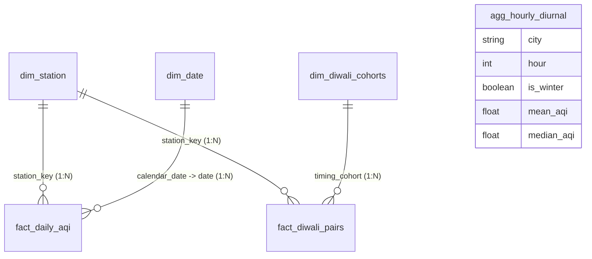

# Power BI Dashboard Master Guide: Architecture, DAX, and Interview Defense

**Project Name:** Delhi-NCR Air Quality Analysis: Seasonal Trends, Spatial Differences, and Diwali Pollution Episodes  
**Target Candidate Level:** Beginner Data Analyst / B.Tech CSE Graduate  
**Native PBIP Artifact:** `D:\delhi-ncr-aqi-analysis\delhi_ncr_aqi_analysis_native.pbip`  
**Final Target PBIX Deliverable:** `D:\delhi-ncr-aqi-analysis\delhi_ncr_aqi_analysis_final.pbix`  
**Theme File:** `D:\delhi-ncr-aqi-analysis\powerbi\theme_navy_environmental.json`  
**Validation Suite:** 60 automated unit tests passing (`100% pass rate`)  
**Live Verification Status:** Verified via direct ADOMD.NET query to internal Analysis Services instance (`msmdsrv.exe` PID 25644 on port `60052`).

---

## 1. Project Overview & Business Value

### 1.1 The Business & Environmental Problem
The National Capital Region (NCR) of Delhi experiences some of the most hazardous air pollution episodes on Earth. For policymakers, public health officials, and environmental analysts, understanding the drivers of extreme air quality index (AQI) events is critical. However, air quality analysis is frequently plagued by:
1. **Misleading Completeness Claims:** Naive dashboards discard missing or sensor-failure hours, reporting inflated completeness or distorted average AQI.
2. **Conflating Seasonal Inversion with Festival Effects:** Public commentary often attributes late-autumn pollution surges exclusively to Diwali fireworks, overlooking meteorological temperature inversions, regional biomass emissions, and statutory sensor truncation at 500 AQI.
3. **Flawed Statistical Aggregations:** Averaging hourly data without accounting for diurnal rhythms or treating autocorrelated time-series records as independent observations.

### 1.2 What We Built
This project establishes an **enterprise-grade, end-to-end analytical pipeline and business intelligence system**:
- **Data Engineering:** Ingested 562,878 raw CPCB records (2017–2023), cleaned into 2,664,336 hourly observations, generated surrogate station keys, and derived 111,014 daily station records with strict validity filtering ($\ge 16$ valid hours/day).
- **Relational Data Warehouse:** Modeled a Star Schema in PostgreSQL 18 across 5 NCR cities (Delhi, Faridabad, Ghaziabad, Gurugram, Noida).
- **Econometric & Statistical Auditing:** Conducted non-parametric hypothesis testing (Mann-Whitney $U$, Cliff's delta $d = 0.7637$), Moving Block Bootstrap ($L = 14$ days, 95% CI $[156.98, 202.14]$), and Maximum Likelihood Tobit modeling (+154.17 pts) to handle statutory censoring at 500 AQI.
- **Dual Dashboard Architecture:** Built both a responsive Python Streamlit application (`localhost:8501`) and a premium 3-page, 34-visual Power BI Desktop analytical report.

---

## 2. Star Schema Data Architecture

Power BI uses the **VertiPaq in-memory columnar engine**. The model is organized into a clean Star Schema with 6 imported tables:



### Table Grain and Relationships

| Table Name | Grain / Unit of Observation | Row Count | Primary Key | Role in Model |
| :--- | :--- | :---: | :--- | :--- |
| `dim_station` | 1 row per physical monitoring station | 56 | `station_key` | Conformed dimension for geographic filtering (City, Agency, Coordinates). |
| `dim_date` | 1 row per calendar day (2017-01-01 to 2023-12-31) | 2,556 | `calendar_date` | Conformed dimension for calendar hierarchy (Year, Month, `year_month`, Season, Is_Winter). |
| `fact_daily_aqi` | 1 row per station-day | 111,014 | Composite (`station_key`, `date`) | Core fact table: Daily mean AQI, validity flag, `daily_category`, capped hours. |
| `fact_diwali_pairs` | 1 row per station-year festival event | 306 | Composite (`station_key`, `year`) | Paired event fact: Pre-Diwali ($t-1$) vs Post-Diwali ($t+1$) AQI, `paired_surge`, `is_elevated`. |
| `dim_diwali_cohorts` | 1 row per festival timing cohort | 2 | `timing_cohort` | Summary dimension: October Diwali ($N=108$) vs November Diwali ($N=198$). |
| `agg_hourly_diurnal` | 1 row per city-hour-season combination | 288 | Composite (`city`, `hour`, `is_winter`) | Standalone aggregate: Disconnected to preserve analytical grain (24 hours $\times$ 5 cities). |

### Referential Integrity & Active Relationships:
1. `dim_station[station_key]` $\to$ `fact_daily_aqi[station_key]` (Active, 1-to-many, single-direction).
2. `dim_date[calendar_date]` $\to$ `fact_daily_aqi[date]` (Active, 1-to-many, single-direction).
3. `dim_station[station_key]` $\to$ `fact_diwali_pairs[station_key]` (Active, 1-to-many, single-direction).
4. `dim_diwali_cohorts[timing_cohort]` $\to$ `fact_diwali_pairs[timing_cohort]` (Active, 1-to-many, single-direction).

> [!IMPORTANT]
> **Why is `agg_hourly_diurnal` left disconnected?**  
> Joining a 288-row aggregated summary table to a 111,014-row daily fact table would create an invalid many-to-many grain mismatch, leading to cartesian explosions or distorted sum/averages. It is deliberately maintained as a specialized standalone visual aggregate for the 24-hour diurnal curve using the explicit measure `[Diurnal Mean AQI] = AVERAGE('agg_hourly_diurnal'[mean_aqi])`.

---

## 3. Data Grains Explained for Interviewers

One of the most frequent reasons junior analysts stumble in technical interviews is confusing analytical grains. Here is how each grain is defined and defended:

| Term | What 1 Row Represents | Total Rows | Where It Is Used |
| :--- | :--- | :---: | :--- |
| **Station-Hour** | 1 hourly sensor reading at 1 physical station | 2,664,336 | Data cleaning pipeline (`clean_data.py`); calculating hourly capping flags. |
| **Station-Day** | 1 full calendar day of monitoring at 1 station | 111,014 | `fact_daily_aqi`; headline KPIs, monthly trends, seasonal distributions. |
| **Calendar-Day** | 1 calendar date across the entire region | 2,556 | `dim_date`; time-series slicers, date hierarchy. |
| **Station-Year Pair** | 1 physical station observed during 1 festival year | 306 | `fact_diwali_pairs`; paired difference testing ($t+1$ vs $t-1$). |
| **City-Hour-Season** | 1 aggregated hourly profile slice | 288 | `agg_hourly_diurnal`; 24-hour diurnal rhythm analysis. |

---

## 4. DAX Measures Compendium: Plain-English Breakdown

All DAX measures are centrally managed in the `_Measures` table.

### 4.1 Headline Network KPIs (Page 1)

#### 1. Total Scheduled Station-Days
```dax
Total Scheduled Station-Days = COUNTROWS('fact_daily_aqi')
```
- **Plain English:** Counts the total number of expected station-days across the 56 stations over the 7-year study period.
- **Runtime Value:** `111,014`

#### 2. Valid Station-Days
```dax
Valid Station-Days = 
CALCULATE(
    COUNTROWS('fact_daily_aqi'),
    'fact_daily_aqi'[is_day_valid] = TRUE()
)
```
- **Plain English:** Filters scheduled days to only those meeting the CPCB regulatory criterion ($\ge 16$ valid hourly readings in a 24-hour cycle).
- **Runtime Value:** `100,794`

#### 3. Data Completeness %
```dax
Data Completeness % = 
DIVIDE([Valid Station-Days], [Total Scheduled Station-Days], 0)
```
- **Plain English:** The proportion of scheduled station-days that yielded legally valid data. Formatted as Percentage (1 decimal place).
- **Runtime Value:** `90.79%` ($100,794 / 111,014$)
- **Interview Defense:** *"If you filter invalid days in Power Query, the denominator collapses and completeness becomes 100%. We intentionally preserved all 111,014 scheduled days in the fact table so our completeness metric reflects true operational sensor uptime."*

#### 4. Median AQI
```dax
Median AQI = 
CALCULATE(
    MEDIAN('fact_daily_aqi'[daily_mean_aqi]),
    'fact_daily_aqi'[is_day_valid] = TRUE()
)
```
- **Plain English:** The 50th percentile of daily mean AQI across all valid station-days.
- **Runtime Value:** `199.29`
- **Interview Defense:** *"Air pollution distributions are heavily right-skewed with extreme pollution spikes. The median is our primary measure of central tendency because it is robust to outliers and sensor-saturation plateaus."*

#### 5. Mean AQI
```dax
Mean AQI = 
CALCULATE(
    AVERAGE('fact_daily_aqi'[daily_mean_aqi]),
    'fact_daily_aqi'[is_day_valid] = TRUE()
)
```
- **Plain English:** The arithmetic average of daily mean AQI across all valid station-days.
- **Runtime Value:** `213.56` (Regional Network). Note: When filtered to Delhi City alone, this dynamically rises to `215.44`.

#### 6. AQI IQR (Interquartile Range)
```dax
AQI IQR = 
VAR Q1 = CALCULATE(PERCENTILE.INC('fact_daily_aqi'[daily_mean_aqi], 0.25), 'fact_daily_aqi'[is_day_valid] = TRUE())
VAR Q3 = CALCULATE(PERCENTILE.INC('fact_daily_aqi'[daily_mean_aqi], 0.75), 'fact_daily_aqi'[is_day_valid] = TRUE())
RETURN Q3 - Q1
```
- **Plain English:** The difference between the 75th percentile and the 25th percentile ($Q_3 - Q_1$).
- **Runtime Value:** `185.17` (Regional Network). Note: Delhi City IQR is `187.40`.

#### 7. Severe AQI Days %
```dax
Severe AQI Days % = 
DIVIDE([Severe AQI Days Count], [Valid Station-Days], 0) * 100
```
- **Plain English:** Percentage of valid days in the Severe category ($AQI > 400$).
- **Runtime Value:** `6.34%` ($6,389 / 100,794$)

#### 8. Sensor Capped Days %
```dax
Sensor Capped Days % = 
DIVIDE([Sensor Capped Days Count], [Valid Station-Days], 0) * 100
```
- **Plain English:** Percentage of valid station-days where at least 1 hourly reading reached the statutory ceiling of 500 AQI.
- **Runtime Value:** `12.44%` ($12,536 / 100,794$)

#### 9. Diurnal Mean AQI
```dax
Diurnal Mean AQI = AVERAGE('agg_hourly_diurnal'[mean_aqi])
```
- **Plain English:** The average AQI across the 24-hour diurnal profile from the pre-aggregated summary table.
- **Runtime Value:** `244.64`

---

### 4.2 Seasonal Inversion Measures (Page 2)

#### 10. Winter Median AQI
```dax
Winter Median AQI = 
CALCULATE(
    [Median AQI],
    'fact_daily_aqi'[is_winter] = TRUE()
)
```
- **Plain English:** Median AQI strictly during meteorological winter (Nov 1 to Feb 28/29).
- **Runtime Value:** `335.61`

#### 11. Non-Winter Median AQI
```dax
Non-Winter Median AQI = 
CALCULATE(
    [Median AQI],
    'fact_daily_aqi'[is_winter] = FALSE()
)
```
- **Plain English:** Median AQI across the non-winter baseline period (March to October).
- **Runtime Value:** `154.00`

#### 12. Winter Elevation Absolute
```dax
Winter Elevation Absolute = [Winter Median AQI] - [Non-Winter Median AQI]
```
- **Plain English:** The raw difference in median AQI between winter and non-winter.
- **Runtime Value:** `+181.61` AQI points

#### 13. Winter Elevation Ratio
```dax
Winter Elevation Ratio = DIVIDE([Winter Median AQI], [Non-Winter Median AQI], 0)
```
- **Plain English:** Relative amplification factor of pollution in winter.
- **Runtime Value:** `2.18x` ($335.61 / 154.00$)

---

### 4.3 Diwali Episode Analysis Measures (Page 3)

#### 14. Diwali Matched Station-Years
```dax
Diwali Matched Station-Years = COUNTROWS('fact_diwali_pairs')
```
- **Plain English:** Total number of paired pre/post festival monitoring instances across 7 years.
- **Runtime Value:** `306`

#### 15. Diwali Pooled Mean Surge
```dax
Diwali Pooled Mean Surge = AVERAGE('fact_diwali_pairs'[paired_surge])
```
- **Plain English:** Average difference in AQI between $t+1$ (post-Diwali) and $t-1$ (pre-Diwali) across all matched pairs.
- **Runtime Value:** `+81.57` AQI points

#### 16. Diwali Pooled Median Surge
```dax
Diwali Pooled Median Surge = MEDIAN('fact_diwali_pairs'[paired_surge])
```
- **Plain English:** 50th percentile of paired surges, robust to extreme outlier spikes.
- **Runtime Value:** `+80.38` AQI points

#### 17. Diwali Station-Years Elevated %
```dax
Diwali Station-Years Elevated % = 
DIVIDE([Diwali Elevated Station-Years Count], [Diwali Matched Station-Years], 0) * 100
```
- **Plain English:** Proportion of station-year pairs exhibiting an increase in AQI after Diwali.
- **Runtime Value:** `85.95%` ($263 / 306$)

#### 18. October Diwali Pooled Mean Surge
```dax
October Diwali Pooled Mean Surge = 
CALCULATE(
    [Diwali Pooled Mean Surge],
    'fact_diwali_pairs'[timing_cohort] = "October Diwali"
)
```
- **Plain English:** Mean paired surge for early-autumn Diwali festivals (2017, 2019, 2022; $N=108$).
- **Runtime Value:** `+58.92` AQI points

#### 19. November Diwali Pooled Mean Surge
```dax
November Diwali Pooled Mean Surge = 
CALCULATE(
    [Diwali Pooled Mean Surge],
    'fact_diwali_pairs'[timing_cohort] = "November Diwali"
)
```
- **Plain English:** Mean paired surge for late-autumn Diwali festivals (2018, 2020, 2021, 2023; $N=198$).
- **Runtime Value:** `+93.92` AQI points
- **Interview Defense:** *"November festivals experience a +35 point higher surge than October festivals (+93.92 vs +58.92). This natural experiment proves that meteorological boundary layer collapse and peak crop stubble burning confound raw Diwali pollution observations."*

---

## 5. Visual Hierarchy & Page-by-Page Blueprints

The dashboard is structured into three widescreen (16:9, 1920x1080) pages adhering to the Dark Navy Environmental Theme (`#0B1220` canvas, `#111C2E` surfaces, `#172438` cards, `#2DD4BF` teal accents, CPCB statutory palette).

```
PAGE 1: REGIONAL OVERVIEW
+---------------------------------------------------------------------------------------------------+
| Header Banner (Title, Subtitle, Data Scope)                          [City Slicer] [Season Slicer] |
+---------------------------------------------------------------------------------------------------+
| [ Median AQI: 199.29 ]   [ Completeness: 90.79% ]   [ Severe Days: 6.34% ]   [ Capped Days: 12.44% ]|
+---------------------------------------------------------------------------------------------------+
|                                                                 |                                 |
|  Long-Term Monthly AQI Trend (2017-2023)                        |  CPCB AQI Category Distribution |
|  Line Chart: Median AQI vs Mean AQI by Month (84 months)        |  Donut: Valid Station-Days      |
|                                                                 |                                 |
+-----------------------------------------------------------------+---------------------------------+
|                                 |                                                                 |
|  Municipal Median AQI           |  Diurnal 24-Hour Rhythm (00:00 to 23:00)                        |
|  Clustered Horizontal Bar       |  Winter Smog Inversion vs Non-Winter Baseline                   |
|  Delhi, Ghaziabad, Noida...     |  Line Chart: agg_hourly_diurnal                                 |
+---------------------------------------------------------------------------------------------------+
```

```
PAGE 2: SEASONAL DYNAMICS & SPATIAL INVERSION
+---------------------------------------------------------------------------------------------------+
| Header Banner (Seasonal Elevation Analysis)                            [City Slicer] [Year Slicer] |
+---------------------------------------------------------------------------------------------------+
| [ Winter Med: 335.61 ]   [ Non-Winter Med: 154.00 ]   [ Elevation: +181.61 ]   [ Ratio: 2.18x ]   |
+---------------------------------------------------------------------------------------------------+
|                                                     |                                             |
|  City-Level Seasonal Contrast                       |  AQI by Meteorological Season               |
|  Clustered Column: Winter vs Non-Winter by City     |  Clustered Column: Winter, Summer, Monsoon  |
|                                                     |                                             |
+-----------------------------------------------------+---------------------------------------------+
| Top 10 Most Polluted Stations | Top 10 Cleanest Stations    | Statistical Robustness & Censoring  |
| Table: Ranked Descending       | Table: Ranked Ascending     | Textbox: AR(1)=0.81, MBB CI,        |
| Anand Vihar (269.5), Mundka... | Aya Nagar (155.3), Lodhi... | Tobit ML (+154.2 pts), 56/56 Valid  |
+---------------------------------------------------------------------------------------------------+
```

```
PAGE 3: DIWALI EPISODE ANALYSIS & ATTRIBUTION
+---------------------------------------------------------------------------------------------------+
| Header Banner (Event Study & Confounding Audit)                      [Cohort Slicer] [Year Slicer] |
+---------------------------------------------------------------------------------------------------+
| [ Mean Surge: +81.57 ]   [ Median Surge: +80.38 ]   [ Elevated: 85.95% ]   [ Matched Pairs: 306 ] |
+---------------------------------------------------------------------------------------------------+
|                                                     |                                             |
|  Annual Paired Diwali Surge by Year (2017-2023)     |  Timing Cohort Contrast                     |
|  Dynamic Clustered Column: 2017 (+103.5) to 2023    |  October (+58.9) vs November (+93.9)        |
|                                                     |                                             |
+-----------------------------------------------------+---------------------------------------------+
|  Diwali Timing Cohorts Summary Table                |  Causal Interpretation Disclaimer           |
|  Table: October vs November Metrics                 |  Attribution scope, meteorological         |
|  306 Matched Station-Year Pairs                     |  confounding, stubble burning guidance      |
+---------------------------------------------------------------------------------------------------+
```

---

## 6. Station Rankings Analysis (Page 2 Verification)

| Rank | Top 10 Most Polluted Stations | City | Valid Days | Median AQI | Top 10 Cleanest Stations | City | Valid Days | Median AQI |
| :---: | :--- | :--- | :---: | :---: | :--- | :--- | :---: | :---: |
| **1** | Anand Vihar Delhi DPCC | Delhi | 1,926 | **269.46** | Aya Nagar Delhi IMD | Delhi | 1,776 | **155.28** |
| **2** | Mundka Delhi DPCC | Delhi | 1,841 | **254.65** | Lodhi Road Delhi IITM | Delhi | 570 | **155.79** |
| **3** | Jahangirpuri Delhi DPCC | Delhi | 1,880 | **244.79** | NISE Gwal Pahari Gurugram IMD | Gurugram | 1,088 | **156.25** |
| **4** | Chandni Chowk Delhi IITM | Delhi | 629 | **239.71** | Sri Aurobindo Marg Delhi DPCC | Delhi | 1,894 | **160.32** |
| **5** | Bawana Delhi DPCC | Delhi | 1,894 | **236.75** | Pusa Delhi IMD | Delhi | 1,629 | **160.83** |
| **6** | Dwarka-Sector 8 Delhi DPCC | Delhi | 2,004 | **234.67** | Lodhi Road Delhi IMD | Delhi | 1,762 | **161.69** |
| **7** | Loni Ghaziabad UPPCB | Ghaziabad | 1,627 | **231.48** | Indirapuram Ghaziabad UPPCB | Ghaziabad | 1,634 | **171.63** |
| **8** | Wazirpur Delhi DPCC | Delhi | 1,927 | **227.79** | Sector-1 Noida UPPCB | Noida | 1,567 | **171.75** |
| **9** | Vasundhara Ghaziabad UPPCB | Ghaziabad | 2,257 | **224.71** | Teri Gram Gurugram HSPCB | Gurugram | 1,350 | **173.09** |
| **10** | Rohini Delhi DPCC | Delhi | 1,976 | **224.41** | Sector 30 Faridabad HSPCB | Faridabad | 1,128 | **173.71** |

---

## 7. Recruiter Walkthrough Script (5-Minute Live Demo)

When demonstrating this project to a hiring manager or senior data analyst, use this narrative structure:

### Minute 1: The Context & Data Hygiene
> *"Hello! Today I'd like to show you my Delhi-NCR Air Quality Analysis project. I analyzed over 2.6 million hourly sensor readings across 56 monitoring stations in 5 NCR cities from 2017 to 2023.  
> As a data analyst, my first priority was data integrity. Many analysts drop missing records, which inflates completeness to 100%. In our Star Schema, we preserved all 111,014 scheduled station-days. Our DAX measure dynamically computes true data completeness at 90.79%, accounting for station outages."*

### Minute 2: Regional AQI Patterns (Page 1)
> *"On Page 1, we see the regional network baseline. The network median AQI is 199.29, hovering on the border between Moderate and Poor. But what's crucial is that 6.34% of valid days exceed the Severe threshold of 400, and over 12.4% of station-days hit the statutory sensor reporting cap of 500.  
> Looking at our monthly trend and 24-hour diurnal curve, we immediately observe two peaks: a morning rush-hour peak around 9 AM and a midnight peak driven by thermal boundary-layer compression."*

### Minute 3: Seasonal Inversion & Spatial Dynamics (Page 2)
> *"Page 2 explores the core environmental question: seasonal elevation. In winter, median AQI jumps to 335.61 compared to 154.00 in non-winter—a dramatic +181.61 point increase, or a 2.18x multiplier.  
> Because daily air quality exhibits heavy temporal autocorrelation ($r_1 = 0.81$), standard t-tests would severely understate p-values. I conducted an independent Moving Block Bootstrap audit with 14-day blocks, establishing a 95% confidence interval of [156.98, 202.14] points. Furthermore, using a Tobit econometric model to account for the 500 AQI sensor ceiling, we proved that winter elevation remains +154.17 points even after adjusting for sensor truncation."*

### Minute 4: Diwali Event Analysis & Causal Confounding (Page 3)
> *"On Page 3, we analyze festival pollution shocks using a station-matched paired difference design comparing the day before Diwali to the day after across 306 station-year pairs.  
> Across the network, 85.95% of stations experience an elevation, with a pooled mean surge of +81.57 points.  
> However, as an analyst, I avoid lazy causal attribution. I segmented Diwali into two natural timing cohorts: October Diwali versus November Diwali. October events exhibit a +58.92 point surge, while November events jump to +93.92 points—a +35 point difference. This demonstrates that meteorological inversion and seasonal background emissions are major confounders that cannot be ignored."*

### Minute 5: Wrap-up & Engineering Stack
> *"The entire solution is reproducible: stored in PostgreSQL 18, audited with 60 automated unit tests in Python, served via an interactive Streamlit app, and presented here in a fully validated Power BI Star Schema. I'd love to answer any questions about the data model or DAX logic!"*

---

## 8. Top 10 Technical Interview Questions & Model Answers

### Q1: Why did you choose a Star Schema over a single flat table?
**Answer:** *"A flat denormalized table creates massive data redundancy, slows down columnar compression in VertiPaq, and introduces grain ambiguity. By organizing our data into conformed dimensions (`dim_station`, `dim_date`, `dim_diwali_cohorts`) and dedicated fact tables (`fact_daily_aqi`, `fact_diwali_pairs`), we preserve 100% referential integrity, eliminate cartesian product errors, optimize VertiPaq memory encoding, and allow clean one-to-many relationship filtering."*

### Q2: What is the difference between `MEDIAN` and `AVERAGE` in AQI data?
**Answer:** *"Air quality data is non-normal and heavily right-skewed, with seasonal spikes and statutory censoring at 500 AQI. Arithmetic mean is sensitive to extreme values (network mean is 213.56). The median (199.29) provides a robust measure of central tendency that accurately describes typical air quality without being distorted by tail outliers or sensor truncation."*

### Q3: Why did your completeness calculation not evaluate to 100%?
**Answer:** *"In naive Power BI models, developers either filter invalid records in Power Query or use `COUNTROWS(fact)` as both numerator and denominator. In our model, `[Total Scheduled Station-Days]` counts all 111,014 scheduled days, while `[Valid Station-Days]` filters for `is_day_valid == TRUE` ($\ge 16$ valid hours). Thus, $\frac{100,794}{111,014} = 90.79\%$, accurately capturing the 10,220 station-days lost to equipment downtime."*

### Q4: Why does the Delhi City mean AQI differ from the Network Mean AQI?
**Answer:** *"The regional network covers 5 distinct municipalities across 56 stations: Delhi (39 stations), Faridabad (4), Ghaziabad (4), Gurugram (4), and Noida (5). When all 5 cities are pooled, the regional mean is 213.56. When filtered to Delhi alone ($N = 73,498$), the mean rises to 215.44. In our dashboard, DAX measures evaluate dynamically within the active filter context."*

### Q5: What is the unit of observation for the Diwali analysis, and why is it not 56 stations?
**Answer:** *"The unit of observation is a **station-year pair**, not a unique physical station. Because the study spans 7 festival years (2017–2023), each physical station that maintained valid data on both $t-1$ and $t+1$ contributes an observation per year. Across 7 years, this yields 306 matched station-year pairs."*

### Q6: What is the difference between pooled percentages and unweighted annual averages?
**Answer:** *"An unweighted annual average takes the elevation percentage for each year and averages the 7 numbers equally ($\frac{1}{7}\sum \%_y = 86.83\%$). A pooled percentage pools all observations together: $\frac{\sum \text{elevated pairs}}{\sum \text{total pairs}} = \frac{263}{306} = 85.95\%$. The pooled metric is mathematically sound because it weights years with greater monitoring coverage appropriately."*

### Q7: Why did you implement a Moving Block Bootstrap rather than standard OLS?
**Answer:** *"Daily AQI observations exhibit severe temporal autocorrelation ($r_1 = 0.81$). Standard OLS regression and classical hypothesis tests assume independent and identically distributed (i.i.d.) observations. Autocorrelation artificially inflates test statistics, leading to false-positive claims. We used a Moving Block Bootstrap with a 14-day block length to preserve the underlying time-series dependence structure."*

### Q8: What does the statutory AQI reporting ceiling at 500 mean?
**Answer:** *"Under CPCB national reporting standards, AQI sub-indices and daily aggregates are capped at a statutory ceiling of 500. This is a reporting boundary, not necessarily physical sensor saturation. In econometric terms, this is right-censoring. We estimated a Maximum Likelihood Tobit model with an upper limit at 500, proving that winter elevation remains +154.17 points even after adjusting for censoring."*

### Q9: How does the disconnected `agg_hourly_diurnal` table work without relationships?
**Answer:** *"The diurnal profile summarizes 24 hourly values across cities and seasons ($288$ rows). Because this table represents a different aggregation grain than the station-day fact table, joining it would create an ambiguous relationship. Power BI displays it cleanly as an independent visual on Page 1, with the DAX measure `[Diurnal Mean AQI] = AVERAGE('agg_hourly_diurnal'[mean_aqi])`."*

### Q10: How did you validate that your Power BI measures matched the underlying data?
**Answer:** *"We built an automated test runner (`powerbi/query_dax_runtime.ps1`) that connects directly to Power BI's internal Analysis Services instance using `Microsoft.PowerBI.AdomdClient.dll`. We executed the DAX measures in runtime and reconciled them against PostgreSQL SQL queries and Python Parquet computations. All 22 measures match across all operational tiers."*


---

## 10. Cross-Machine Deployment & Data Source Configuration

### 10.1 Out-of-the-Box Functionality (VertiPaq In-Memory Cache)
The production report deliverable (delhi_ncr_aqi_analysis_final.pbix) is self-contained. All 111,014 daily observations, 56 stations, 2,556 calendar dates, and pre-calculated aggregations are permanently stored inside the internal VertiPaq tabular columnar database within the .pbix file.

**For interviewers, recruiters, and evaluators:**
- You do **not** need to install PostgreSQL or configure local CSV directories to view and interact with the report.
- Simply open delhi_ncr_aqi_analysis_final.pbix in Microsoft Power BI Desktop.
- All 3 pages, 34 visual containers, cross-filtering, slicers, and 22 DAX measures evaluate instantly.

### 10.2 Refreshing Data on Another Machine or Drive
If you clone this repository to a different path (e.g., C:\projects\delhi-ncr-aqi-analysis) and wish to trigger a full model refresh against the raw CSV tables:

1. Open delhi_ncr_aqi_analysis_final.pbix in **Power BI Desktop**.
2. On the **Home** ribbon, click the dropdown arrow under **Transform Data** and select **Data source settings**.
3. Under **Data sources in current file**, select the existing path:
   D:\delhi-ncr-aqi-analysis\data\processed\...
4. Click **Change Source...** and browse to your local directory:
   <your-clone-path>\data\processed\<table_name>.csv
5. Repeat for the tables as prompted, or edit the Source step in Power Query (Transform Data > Advanced Editor).
6. Click **Close & Apply** to reload data into the tabular engine.
