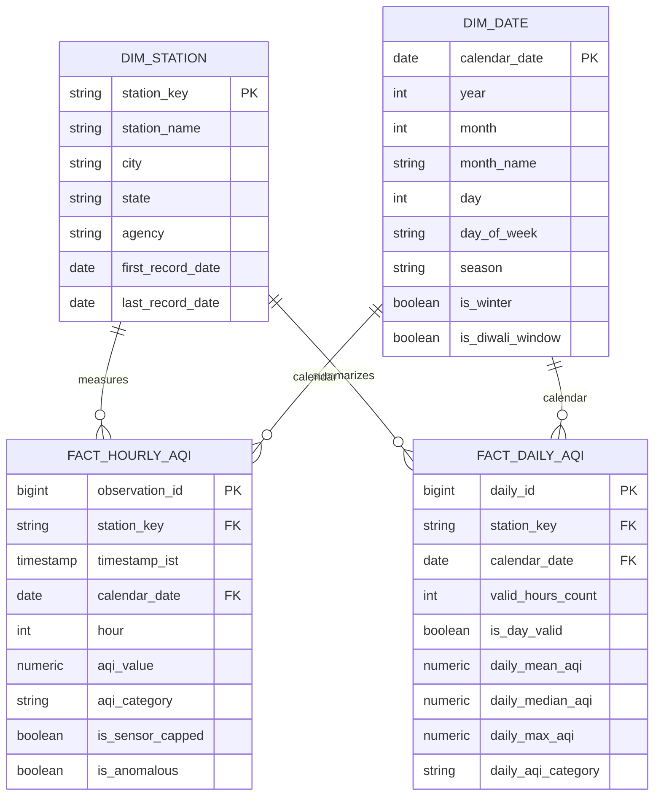

# PostgreSQL & SQL Learning Guide: Air Quality Analytics

This guide details the database architecture, schema design, and advanced analytical SQL patterns used in this project. It is structured to help you master SQL concepts frequently tested in Data Analyst interviews.

---

## 1. Local PostgreSQL 18 & pgAdmin 4 Setup

Both **PostgreSQL 18** and **pgAdmin 4** are installed locally on your Windows system.

### 1.1 Verifying PostgreSQL Service
Open PowerShell and verify the service status:
```powershell
Get-Service *postgres*
```
You will see `postgresql-x64-18` running.

### 1.2 Accessing pgAdmin 4
1. Open the Windows Start menu and launch **pgAdmin 4**.
2. Enter your master password configured during installation.
3. Under **Servers** > **PostgreSQL 18**, right-click **Databases** > **Create** > **Database...**.
4. Name the database: `delhi_aqi`.
5. Open the **Query Tool** on `delhi_aqi` to run scripts.

---

## 2. Relational Schema Architecture (Star Schema)

We design a Kimball-style dimensional model optimized for analytical queries and Power BI direct integration:



---

## 3. High-Impact Analytical SQL Queries Explained

### Query 1: Station-Level AQI Rankings with Window Functions
**Business Question**: *Rank each monitored station by median winter AQI across the 7-year period, identifying the top 5 most polluted stations per city.*

```sql
WITH winter_station_medians AS (
    SELECT 
        s.city,
        s.station_name,
        ROUND(AVG(f.daily_mean_aqi), 2) AS mean_winter_aqi,
        ROUND(PERCENTILE_CONT(0.5) WITHIN GROUP (ORDER BY f.daily_mean_aqi)::numeric, 2) AS median_winter_aqi,
        COUNT(f.daily_id) AS valid_winter_days
    FROM fact_daily_aqi f
    JOIN dim_station s ON f.station_key = s.station_key
    JOIN dim_date d ON f.calendar_date = d.calendar_date
    WHERE d.is_winter = TRUE AND f.is_day_valid = TRUE
    GROUP BY s.city, s.station_name
    HAVING COUNT(f.daily_id) >= 100 -- Filter out short-lived stations
),
ranked_stations AS (
    SELECT 
        city,
        station_name,
        median_winter_aqi,
        valid_winter_days,
        DENSE_RANK() OVER (PARTITION BY city ORDER BY median_winter_aqi DESC) AS city_rank,
        DENSE_RANK() OVER (ORDER BY median_winter_aqi DESC) AS ncr_overall_rank
    FROM winter_station_medians
)
SELECT *
FROM ranked_stations
WHERE city_rank <= 5
ORDER BY city, city_rank;
```

#### SQL Concepts to Master:
- **`PERCENTILE_CONT(0.5) WITHIN GROUP (ORDER BY ...)`**: Calculates the exact mathematical median in PostgreSQL (an essential skill since `MEDIAN()` is not a standard ANSI SQL aggregate function).
- **`DENSE_RANK() OVER (PARTITION BY city ORDER BY ...)`**: Assigns rank numbers resetting per city. Unlike `RANK()`, `DENSE_RANK()` does not skip rank numbers when ties occur.

---

### Query 2: Rolling 7-Day Moving Average During Diwali Windows
**Business Question**: *Calculate a 7-day centered rolling average of AQI across Delhi stations to visualize the rate of pollution accumulation and post-festival dissipation.*

```sql
WITH daily_city_composite AS (
    SELECT 
        f.calendar_date,
        d.year,
        d.is_diwali_window,
        ROUND(AVG(f.daily_mean_aqi), 2) AS city_mean_aqi
    FROM fact_daily_aqi f
    JOIN dim_station s ON f.station_key = s.station_key
    JOIN dim_date d ON f.calendar_date = d.calendar_date
    WHERE s.city = 'Delhi' AND f.is_day_valid = TRUE
    GROUP BY f.calendar_date, d.year, d.is_diwali_window
)
SELECT 
    calendar_date,
    year,
    is_diwali_window,
    city_mean_aqi,
    ROUND(
        AVG(city_mean_aqi) OVER (
            PARTITION BY year 
            ORDER BY calendar_date 
            ROWS BETWEEN 3 PRECEDING AND 3 FOLLOWING
        ), 2
    ) AS rolling_7day_centered_aqi
FROM daily_city_composite
WHERE is_diwali_window = TRUE
ORDER BY calendar_date;
```

#### SQL Concepts to Master:
- **`ROWS BETWEEN 3 PRECEDING AND 3 FOLLOWING`**: Specifies a centered window frame. It smooths day-to-day meteorological noise to reveal the underlying multi-day trajectory.

---

### Query 3: Severity Category Distribution using Conditional Aggregation
**Business Question**: *What proportion of monitored days in each season fall into the 'Severe' ($AQI > 400$) category?*

```sql
SELECT 
    d.season,
    COUNT(f.daily_id) AS total_monitored_days,
    COUNT(CASE WHEN f.daily_mean_aqi <= 50 THEN 1 END) AS good_days,
    COUNT(CASE WHEN f.daily_mean_aqi BETWEEN 51 AND 100 THEN 1 END) AS satisfactory_days,
    COUNT(CASE WHEN f.daily_mean_aqi BETWEEN 101 AND 200 THEN 1 END) AS moderate_days,
    COUNT(CASE WHEN f.daily_mean_aqi BETWEEN 201 AND 300 THEN 1 END) AS poor_days,
    COUNT(CASE WHEN f.daily_mean_aqi BETWEEN 301 AND 400 THEN 1 END) AS very_poor_days,
    COUNT(CASE WHEN f.daily_mean_aqi > 400 THEN 1 END) AS severe_days,
    ROUND(
        COUNT(CASE WHEN f.daily_mean_aqi > 400 THEN 1 END) * 100.0 / COUNT(f.daily_id), 
        2
    ) AS severe_percentage
FROM fact_daily_aqi f
JOIN dim_date d ON f.calendar_date = d.calendar_date
WHERE f.is_day_valid = TRUE
GROUP BY d.season
ORDER BY severe_percentage DESC;
```

#### SQL Concepts to Master:
- **`COUNT(CASE WHEN ... THEN 1 END)`**: Idiomatic SQL pattern for conditional frequency counting. Unlike `SUM()`, `COUNT` ignores `NULL` when the condition is false.
