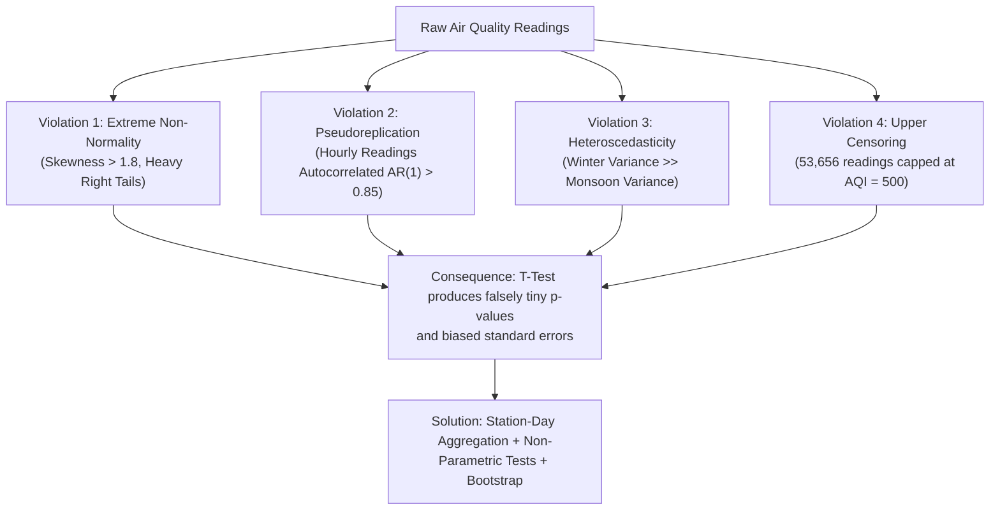

# Statistics Learning Guide: Applied Environmental Data Analysis

This guide explains the inferential statistical methodology applied in this project. As a Data Analyst candidate, knowing *which* test to use and *why* standard textbook assumptions fail in real data is a key differentiator in technical interviews.

---

## 1. Why Textbook Parametric Tests Fail on Pollution Data

In introductory statistics courses, students are taught the **two-sample Student's t-test**. However, applying a Student's t-test directly to ambient AQI data violates nearly all standard Gauss-Markov and parametric assumptions:

### Detailed Breakdown of Violations:
1. **Severe Skewness & Capping**: Air pollution cannot fall below zero (bounded at zero) and features severe positive spikes with an artificial ceiling at 500. The mean and standard deviation become distorted by the upper saturation limit.
2. **Pseudoreplication (Lack of Independence)**: The reading at 3:00 PM at Anand Vihar is heavily dependent on the reading at 2:00 PM at Anand Vihar. Treating $2.44\text{ million}$ hourly readings as $2.44\text{ million}$ independent draws creates an artificially inflated degrees-of-freedom pool ($N \approx 2.44\times 10^6$), yielding $p \approx 0$ even for trivial, meaningless fluctuations.
3. **Unequal Variance (Heteroscedasticity)**: Variance during calm winter inversions is dramatically larger than during the monsoon, violating equal-variance assumptions.

---

## 2. Choosing Defensible Statistical Methods

| Analytical Challenge | Naive / Incorrect Method | Defensible Method Implemented | Why It Is Statistically Sound |
| :--- | :--- | :--- | :--- |
| **Winter vs. Non-Winter Comparison** | Two-sample t-test on all hourly readings ($N=2.44\text{M}$) | **Mann-Whitney $U$ test** and **Paired Wilcoxon signed-rank test** on station-day aggregated medians | Evaluates ranks rather than fragile means; accounts for skewness; aggregates out hourly serial autocorrelation. |
| **Quantifying Difference Magnitude** | Cohen's $d$ based on sample mean and pooled standard deviation | **Cliff's Delta ($d$)** and **Median Difference with 95% Bootstrap CI** | Cliff's Delta is a non-parametric effect size bounded in $[-1, +1]$ that measures the probability that a random winter observation is larger than a non-winter one minus the reverse probability. |
| **Diwali Event Study** | Simple before-and-after single t-test | **Difference-in-Medians Event Study** with pre-event rolling baseline ($t-7$ to $t-1$) | Controls for pre-existing multi-day buildup and evaluates the return-to-baseline trajectory. |

---

## 3. Mathematical Foundations of Chosen Methods

### 3.1 Mann-Whitney $U$ Test
For two independent groups (Winter $W$ of size $n_1$, Non-Winter $NW$ of size $n_2$), all observations are pooled and ranked from 1 to $N = n_1 + n_2$. The test statistic is:
$$U_1 = R_1 - \frac{n_1(n_1 + 1)}{2}$$
where $R_1$ is the sum of ranks in the Winter group. The null hypothesis $H_0$ states that the probability of an observation from $W$ exceeding an observation from $NW$ equals $0.5$.

### 3.2 Cliff's Delta ($d$) Effect Size
Cliff's Delta provides a robust non-parametric effect size metric:
$$d = \frac{\# (x_i > y_j) - \# (x_i < y_j)}{n_1 n_2}$$
where $x_i \in \text{Winter}$ and $y_j \in \text{Non-Winter}$.
- **Interpretation Guidelines**:
  - $|d| < 0.147$: Negligible
  - $0.147 \le |d| < 0.33$: Small
  - $0.33 \le |d| < 0.474$: Medium
  - $|d| \ge 0.474$: Large

### 3.3 Bootstrap Confidence Intervals ($B = 2,000$)
Rather than assuming a theoretical bell curve for sample medians:
1. Resample with replacement from Winter observations ($n_1$ draws) and Non-Winter observations ($n_2$ draws).
2. Calculate the difference in medians $\Delta_b = \text{Median}(W_b^*) - \text{Median}(NW_b^*)$.
3. Repeat $B = 2,000$ times.
4. The 95% confidence interval is extracted empirically from the 2.5th and 97.5th percentiles of the bootstrap distribution: $[\Delta_{0.025}^*, \Delta_{0.975}^*]$.

---

## 4. Association vs. Causation: The Analyst's Responsibility

In business and public sector analysis, executive stakeholders frequently ask: *"Did Diwali cause this spike?"* or *"Did the policy fix the pollution?"*

A professional Data Analyst distinguishes between **association** and **causation**:
- **Empirical Association**: AQI is significantly higher during the Diwali event window ($t_0$ to $t+1$) than during the prior week ($t-7$ to $t-1$).
- **Confounding Factors**: Wind speeds systematically drop in late October; atmospheric boundary layer height declines from $>1,500\text{m}$ to $<400\text{m}$ (trapping identical emissions in a fraction of the air volume); upwind agricultural residue burning peaks simultaneously.
- **Defensible Reporting**: *"Data demonstrates an acute, recurrent pollution episode associated with the Diwali window across all 7 years, but meteorological boundary-layer stagnation is a substantial confounding driver."*
